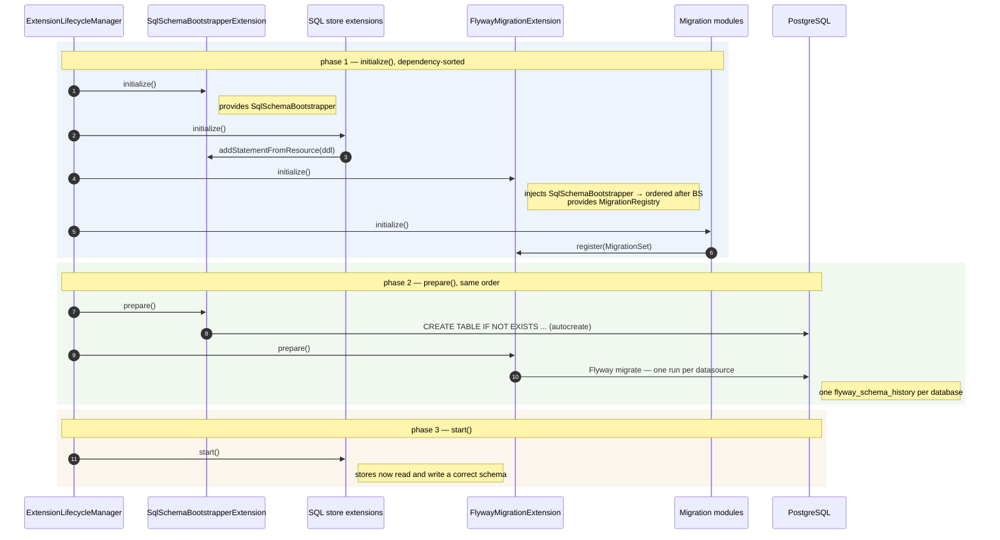

# Flyway Core

Applies the migrations contributed by the migration modules on the runtime classpath, using Flyway.

The module is named after the engine on purpose: Flyway's semantics — versioned scripts, a
`flyway_schema_history` table, checksums, a lock per database — leak into every design decision
below. `migration-spi` stays neutral, so a set module never depends on that choice; this module does
not pretend to.

## How it works

1. Each migration module registers a `MigrationSet` (datasource + classpath location) during
   `initialize()`.
2. `FlywayMigrationExtension.prepare()` groups the sets per datasource and runs Flyway once per
   database, so a database shared by several runtimes has a single `flyway_schema_history`.
3. The extension injects `SqlSchemaBootstrapper`, which places it after
   `SqlSchemaBootstrapperExtension` in the dependency-sorted order. `edc.sql.schema.autocreate` keeps
   creating the tables; migrations only apply deltas.

## Boot sequence

`ExtensionLifecycleManager` runs every `initialize()` first, then every `prepare()`, both in the same
dependency-sorted order. Registration therefore happens entirely in the first pass, and the whole
first pass is over before any migration runs.



The ordering rests on two injections, both load-bearing and neither obvious from the call sites:

| Injection | Effect if removed |
|---|---|
| `FlywayMigrationExtension` injects `SqlSchemaBootstrapper` | Migrations may run before the tables exist. An `ALTER TABLE` on a missing table fails the boot. |
| Migration modules inject `MigrationRegistry` | Modules may initialize before the registry provider, and their sets are never seen. Migrations silently do not run. |

`FlywayMigrationExtensionTest.injectsSqlSchemaBootstrapper_toRunAfterSchemaAutocreate` guards the
first one, since nothing else in the code would fail if the field disappeared.

## Why it works this way

EDC creates its schema at boot through `SqlSchemaBootstrapper`, and every upstream DDL resource uses
`CREATE TABLE IF NOT EXISTS`. That builds a correct schema on an empty database but never alters an
existing one: on a database created by an earlier EDC version the bootstrapper silently does nothing,
and the runtime fails later with a column-not-found error.

- **Migrations run in the runtime, not in a Kubernetes Job.** They run inside the process that owns
  the schema, reuse its credentials and configuration, and their ordering is decided by the extension
  dependency graph rather than by Helm sync waves. The Mobility Data Space connector solves the same
  problem the same way, in
  [`database-schema-migration-connector`](https://github.com/Mobility-Data-Space/mds-edc/tree/main/extensions/database-schema-migration-connector).
- **`edc.sql.schema.autocreate` stays `true`.** The application keeps creating tables; Flyway only
  applies deltas. Owning the whole schema in Flyway would mean copying the 29 upstream DDL resources
  into DSE and re-synchronising them on every EDC upgrade.
- **One `flyway_schema_history` per database, shared by every runtime writing to it.** On UAT one
  database is written by up to five runtimes, all in schema `public`. A history table per runtime
  would fragment the view of that database and leave shared objects such as `edc_lease` without an
  owner. Required by ticket #605 (see ADR-002). The cost is `outOfOrder`, `ignoreMigrationPatterns=*:missing,*:future`
  and globally unique versions.
  - **`*:missing` in particular has to be assumed, not just enabled.** A runtime only ignores versions
    below its own highest one that it does not carry — that is what makes running with history rows
    written by other modules' sets possible at all. But it also means a migration script that gets
    **deleted or renamed** after being deployed stops being flagged: Flyway does not fail, does not
    warn, it just no longer sees that version as pending and treats it as any other row it does not
    carry. If a fix depended on that script running on a database it has not reached yet, removing the
    script silently cancels the fix there, with nothing in the logs to say so.
- **No state-dependent baseline** (`baselineOnMigrate=true`, `baselineVersion=0`). Manual migrations
  were applied twice in the past without being recorded, so the prior state of a given database is not
  knowable. Idempotent migrations replay harmlessly, which removes the need to know it.

The trade-off: idempotent migrations are not idiomatic Flyway, and the two settings above weaken its
consistency checks. Version collisions are prevented by convention, not by tooling — hence the review
rules below.

## Configuration

| Setting | Default | Description |
|---|---|---|
| `edc.migration.enabled` | `true` | When false, nothing is applied. For debugging a failing migration, not for normal operation. |
| `edc.migration.lock.retry.count` | `50` | Flyway lock retries, one second apart. Runtimes sharing a database serialise on this lock, so it must cover the slowest of them booting. See the boot budget below before changing it. |
| `edc.participant.id` | — | Exposed to migrations as the `${participantContextId}` placeholder. |

## Boot budget in Kubernetes

Migrations run before the runtime serves any HTTP, so every probe fails while they are running. What
bounds the boot is therefore the probe configuration, not the migration itself.

Without a startup probe, the budget is the liveness probe's: with the chart defaults
(`initialDelaySeconds: 5`, `periodSeconds: 10`, `failureThreshold: 6`) that is **65 seconds** from
container start — JVM startup, extension boot, lock wait and migrations included. `dataspace-charts`
adds a startup probe to the control-plane and data-plane charts for that reason, which suspends
liveness and readiness and raises the budget to **5 minutes**. The other charts need the same
treatment when their migration sets land.

The lock wait is the part that grows: runtimes sharing a database serialise on the Flyway advisory
lock, so the last one to boot waits for all the others. On UAT five runtimes write to
`dse_uat_eonaxdb`.

```
boot budget  ≥  JVM startup + extension boot + (runtimes sharing the database − 1) × migration time
lock wait    ≤  edc.migration.lock.retry.count seconds   (one retry per second)
```

Raising `edc.migration.lock.retry.count` without raising the probe budget only changes how the pod
dies: waiting for the lock instead of failing on it. A pod killed mid-migration is the case to avoid
— PostgreSQL rolls the statement back, but the Flyway lock is released only when the connection
drops, so the next pod may wait it out.

## Writing a migration

- File name: `V<YYYYMMDD>.<n>__<description>.sql`. Sequential integers are rejected in review: every
  module writes to the same history table, so versions must be globally unique.
- **Every statement must be idempotent** (`ADD COLUMN IF NOT EXISTS`, `DROP COLUMN IF EXISTS`, updates
  tolerating zero rows). A migration runs against databases created by the application itself, whose
  shape depends on the version that created them.
- PostgreSQL has no `ADD CONSTRAINT IF NOT EXISTS`: check `pg_constraint` on the constrained
  **columns**, not on the constraint name — inline upstream declarations are auto-named.
- A destructive statement needs an explicit reason why nothing of value is lost, not just
  `IF EXISTS`.
- An object declared by more than one upstream module belongs in `migration-shared`, never in a
  per-store module.
- **Once a migration has been deployed, its file is frozen — comments included.** Flyway stores a
  checksum of the whole file and refuses to boot against a database whose history says the same
  version was applied with different content. Fixing a typo in a comment is enough to break every
  runtime already carrying that version. Correct a deployed migration by adding a new one; edit the
  file only while it is still unreleased. This is the same mechanism that
  `divergentCopyOfMigration_failsTheBoot` demonstrates for copy-pasted modules.

## Worked example: a feature that changes the schema

Say the telemetry record has to carry a billing reference. The table is `edc_telemetry_record`, owned
by DSE's own `extensions/common/store/sql/telemetry-store-sql`.

**The rule to internalise: a schema change lands in two places.** The DDL resource handles databases
that do not exist yet; the migration handles the ones that already do. Each one alone passes in one
environment and fails in the other:

| Only the DDL is changed | Only the migration is added |
|---|---|
| A fresh deployment is correct. Every existing database — dev, UAT, all 21 participants — silently keeps the old shape, and the runtime fails on a column-not-found error the first time the feature runs. | Existing databases are correct. A brand-new participant gets the migration applied to a table the DDL already created in the new shape — which works, but only because the migration is idempotent. Drop that discipline and fresh deployments break. |

### 1. Update the DDL resource — for databases that do not exist yet

`extensions/common/store/sql/telemetry-store-sql/src/main/resources/telemetry-record-schema.sql`:

```sql
CREATE TABLE IF NOT EXISTS edc_telemetry_record
(
    record_id         VARCHAR NOT NULL CONSTRAINT record_pk PRIMARY KEY,
    ...
    billing_reference VARCHAR
);
```

### 2. Add the migration — for databases that already exist

Because DSE owns this store, the migration set lives inside the store module rather than in a
separate one. Separate modules exist only for upstream stores, which cannot be modified.

`extensions/common/store/sql/telemetry-store-sql/src/main/resources/db/migration/telemetry-record/V20260810.1__add_billing_reference.sql`:

```sql
-- Nullable, so no backfill and no NOT NULL to enforce: existing records predate billing references
-- and have none. The column must still exist before the app starts, because the store's query
-- templates reference it unconditionally.
ALTER TABLE edc_telemetry_record ADD COLUMN IF NOT EXISTS billing_reference VARCHAR;
```

Pick the version from today's date, and bump `.n` if a migration with that date already exists **in
any module** — they all share one history table.

If the column had to be `NOT NULL`, the migration would be three statements, in this order: add it
nullable, backfill every existing row, then enforce the constraint. Enforcing it before the backfill
fails on any database that holds data — which is every database except a developer's.

### 3. Register the set

In `SqlTelemetryRecordStoreExtension`:

```java
@Inject
private MigrationRegistry migrationRegistry;

@Override
public void initialize(ServiceExtensionContext context) {
    migrationRegistry.register(new MigrationSet(NAME, dataSourceName, "classpath:db/migration/telemetry-record"));
    ...
}
```

Registration must happen in `initialize()`: `prepare()` is too late, migrations have already run.
Add `implementation(project(":spi:migration-spi"))` to the module's `build.gradle.kts`, and
`runtimeOnly(project(":extensions:common:migration:flyway-core"))` to every launcher that carries
the store — without the core module on the classpath the registry does not exist and the runtime
fails to boot on an unresolved injection.

### 4. Update the ER diagram

`extensions/common/store/sql/telemetry-store-sql/docs/er.puml`. Nothing regenerates it; it drifts
silently otherwise.

### 5. Test both starting states

Extend `PostgresFlywayMigrationTest` — or add the equivalent in the store module — with the two paths
that matter: a database in the old shape plus rows, and one created by the new DDL. Assert that they
end up identical and that the existing rows survived. An assertion on an empty database proves
nothing about a backfill.

### When no migration is needed

A **brand-new table** needs only the DDL resource: `CREATE TABLE IF NOT EXISTS` behaves correctly on
both a fresh and an existing database. A migration is required as soon as an *existing* object
changes, or as soon as new data has to be derived from data already stored.

## Tests

**Migration sets are discovered from the source tree** (`MigrationScripts`), not listed anywhere. A
migration module added later is covered by all of the tests below without anything being wired in —
which is what a hardcoded list gets wrong: it stays green while being silently incomplete.

| Test | What it would catch | Runs |
|---|---|---|
| `MigrationConventionTest` | A version that is not `V<YYYYMMDD>.<n>`, or two modules using the same version — fatal at boot on any database carrying both, and invisible in a single module's diff. | unit |
| `UpstreamSchemaFixtureTest` | An EDC upgrade changing the DDL without the fixtures and migrations following. Everything below would stay green while testing a schema no deployment has. | unit |
| `PostgresMigrationReplayTest` | A statement that is not idempotent. Flyway cannot catch this: it records a version once applied and never re-executes it. The test applies every script twice, outside Flyway, from both starting shapes. | CI `test:integration` |
| `PostgresFlywayMigrationTest` | A migrated database diverging from a freshly created one, in columns, constraints or indexes; a backfill missing rows; two runtimes with different sets or booting concurrently; a copy of a migration that drifted. | CI `test:integration` |

The two fixtures under `src/test/resources/fixtures/` are the real upstream DDL plus the matching DSE
`telemetry-record-schema.sql`. `schema-<edc version>.sql` is checked against the store jars on the
test classpath, so it cannot drift from the version being built; when the check fails it writes the
regenerated content to `build/reports/` for you to diff and copy over. The fixture for a version the
build does not depend on — `schema-0.15.sql` while the branch is on 0.14 — is assembled by hand from
the corresponding tag and starts being verified when the EDC version is bumped.

`seed-0.14.sql` holds rows in the old shape: on an empty database a backfill touches nothing and the
`SET NOT NULL` that follows passes whatever the backfill does.

**Adding a store to the covered set** means adding its DDL resource to `DDL_RESOURCES` in
`UpstreamSchemaFixtureTest`, its module to the test dependencies, and regenerating the fixtures.

### What is still not covered

- Anything touching a table absent from the fixtures. The fixtures cover the control-plane,
  data-plane, identity-hub and issuer-service stores; see the coverage table below for what is left.
- A backfill on a column no row in `seed-0.14.sql` exercises. New column, new seed row.
- The real EDC boot: extension ordering is checked by a reflection test on the injected
  `SqlSchemaBootstrapper`, not by starting a runtime.

## Which runtimes have a migration set

The runtimes of one participant share a single database, so a table is not owned by whoever happens
to boot first. This table records that ownership. **An empty cell means "nothing to migrate yet", not
"nothing to do"** — the distinction matters, because an absent set reads like a decision when it may
just be an oversight.

| Runtime | Migration set | Tables it owns |
|---|---|---|
| control-plane | `control-plane-migration` | transfer process, negotiation, agreement, asset, policy, contract definition, EDR |
| data-plane | `data-plane-migration` | data plane, data plane instance, telemetry record |
| identity-hub | `identity-hub-migration` | credential resource, keypair, DID, participant context, STS client, credential offer, holder credential request |
| issuer-service | `issuer-service-migration` **and** `identity-hub-migration` | holders, issuance process — plus the seven tables above, which both SQL BOMs declare |
| — all of the above — | `migration-shared` | `edc_lease`, declared by nine upstream store modules and owned by none |
| federated-catalog | none | No DDL change between EDC 0.14.0 and 0.15.0. |
| telemetry-agent, -service, -storage, -csv-manager | none | Their schemas are DSE's own, so an EDC upgrade cannot change them. They need a set the day *we* change one — see the worked example above. |

Two consequences worth keeping in mind:

- **The issuer-service carries the identity-hub set.** Five upstream store modules
  (`identity-hub-credentials`, `-did`, `-keypair`, `-participantcontext`, `sts-client`) sit in both
  SQL BOMs, so both runtimes create those tables and either may boot first. Wiring the set into only
  one of them would make the migration depend on boot order.
- **A BOM can grow without any file here changing.** The launchers depend on
  `identityhub-feature-sql-bom` and friends, not on individual store modules; an EDC upgrade can add
  a store, and therefore a table, invisibly. `UpstreamSchemaFixtureTest` is what turns that into a
  build failure.

### Destructive steps, and why they are accepted

Migrations here are idempotent and additive with three exceptions, each of which discards data:

| Statement | Why it is safe |
|---|---|
| `DROP TABLE edc_lease CASCADE` (shared) | Leases live for seconds and are re-acquired by the runtime. |
| `DROP COLUMN lease_id` (control-plane, data-plane, identity-hub, issuer-service) | The column is gone from the 0.15 model; the lease is keyed by resource now. |
| `DROP COLUMN private_key_alias`, `public_key_reference` (`edc_sts_client`) | Both fields were removed from `StsAccount` in 0.15 — the key material is held by the keypair resource. The aliases they held are still in the vault; nothing reads these columns after the upgrade. |

The last one is the one to re-check before the 0.15 rollout: it is the only case where a column
holding a pointer to vault material is dropped rather than migrated.
